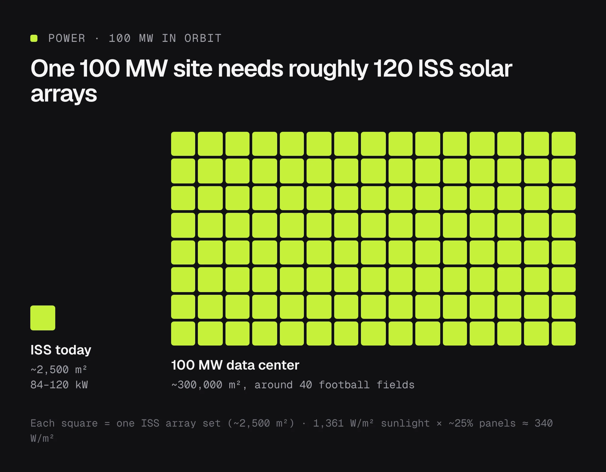

Been reading on topic of data centers in space for a while, i dont claim to be an expert but here are some points that stood out to me in my research

**Is it technically doable:** Yes, we already did it at a very small scale. a company called Starcloud flew an Nvidia H100 to orbit last year and trained a model on it. The problem is scaling up to an actual data center. A regular data center not those big ones owned by spacex or openai,

Take a 100 MW AI data center. That’s not even big anymore. Hyperscale campuses are heading past 1 GW.

## Power

Sunlight in orbit is about 1,361 W/m². With ~25% efficient panels you get roughly 340 W/m².

100 MW needs about 300,000 m² of solar panels. Around 40 football fields long solar panels.

The International Space Station ( ISS) has the largest solar arrays ever flown by humans and it is only about 2,500 m², producing 84 to 120 kW.

So one 100 MW site needs roughly 120 ISS worth of solar arrays.

- It took over 10 years to build at first but i don't think building it gonna be a problem with the huge advancements that happened in solar technology, the main issue is how are you gonna lift 300,000 m² of solar panels? According to my calculations( claude's ) using the nest solar panels on the market, 300k m² of solar panels will weight 830,000 KG - 1 milllion KG, even with the new starship ( can carry 100,000 KG payloads) it will take 8-10 trips.
- this is an obstacle we can get over absolutely, give it 20 years maybe. who know maybe there will be a future where we figure out how to built mini nuclear stations in space to solve the power issue, but then the question shifts to do you really want a nuclear reactors to fly over your head 24/7 ,possible giving you radioactive showers in case of a malfunction?

## Cooling

Space is cold, but a vacuum doesn’t carry heat away. The only way out is radiating it using big radiators.

100 MW needs about 1.2 million m² of radiators ( using ISS scale). That’s ~1,400 ISS radiator sets.

Even using Starcloud’s figure (~630 W/m² at 20°C), it’s still ~160,000 m². About 190 ISS radiator sets, or 22 football fields. which will weight 1,300,000 to 9,600,000 KG of radiators alone.

## Other Problems

Most GPU get absolute in 3-5 years, who is changing GPU up there when ever jensen releases the next chip? and image other problems like radiation damage, dead GPUs etc

the other thing i think will be a problem is that both software and hardware move too fast, new architecture brings new formats, new chips bring new schema, power and heat go up each generation, unless you know in advance how are you designing housing for these GPUs? or are they gonna hold off on progress since the satelitte designed wont fit theri new GPUs?

AI Labs are always looking for the newest and best so old orbital capacity gets pushed to cheaper inference work at lower prices.

## So is it doable?

from what i think, Yes but only on small orbital compute. It’s already happening now

A real data center in space is physically possible, the same way building another Great Pyramid of Giza is possible. Could we build it? Yes. Should we? No, because you’d spend billions and get nothing back that a normal building couldn’t give you for a fraction of the price.

Data centers in space are the same. physically possible. Economically pointless, for now.

Launch costs would need to drop around 10x from the current cost a falcon 9 or a starship launch just to get close to Earth prices. Even then you’d still have radiators that you can see from earth with your bare eyes, GPUs nobody can repair, and hardware you can’t upgrade without launching a whole new satellite.

But I would love to see elon attempt this, this will be the greatest engineering project in history, humans attempt. even failing this would make use learn alot.

i just don’t trust the timeline. he says space will be the cheapest place to run AI within 2 to 3 years. This is the same guy who promised a million robotaxis by 2020, humans on Mars by 2024, and full self-driving “next year” every year for a decade. i think elon time is its own unit of measurement.

my bet? We get a couple of server racks launched to space, a slick livestream, a “SEE, IT WORKS” tweet, a nice bump for the stock, and then the actual data center quietly slides 20 years later. it wouldn’t surprise me one bit.

## In Conclusion

Not impossible. Just not the easy fix for AI’s power problem it’s being sold as by elon.
