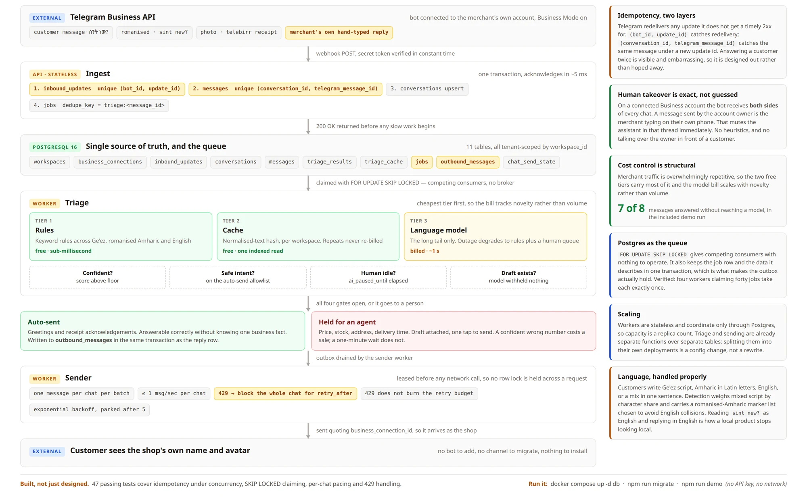

A large share of Ethiopian retail runs through Telegram DMs. That works until it doesn't:
one inbox on one phone, no history when a second person helps out, no way to tell an
unanswered question from a handled one. Customers who don't get an answer in a few minutes
go to the next shop.

Mesob puts a real inbox behind that phone without asking the merchant to change how they
work, or the customer to install anything. It is a working backend slice, not a mockup:
ingest, queue, triage, outbox and delivery all run, and 47 tests cover the concurrency
behaviour that matters.

## Telegram Business, not a bot

The Business API lets a bot act as the account owner, so customers keep messaging the same
person and see the shop's own name. It also means Mesob sees both sides of the
conversation: a message from the owner is the merchant typing by hand, which is a free and
exact signal to mute the assistant in that thread.

## Postgres is the queue

`FOR UPDATE SKIP LOCKED` gives competing consumers without a broker, and keeps job rows in
the same transaction as the data they describe, which is what makes the outbox pattern
hold. Four workers claiming 40 jobs claim each one exactly once.

Telegram retries anything that isn't a 2xx, so idempotency lives at two layers: the update
id and the message id. Replaying a whole morning of traffic concurrently stores nothing
twice.

## Triage, cheapest first

Rules, then cache, then model. Merchant traffic is repetitive, so the free tiers answer most
of it; in the demo, 7 of 8 messages never reach a model. The bill scales with novelty, not
volume, and a model outage degrades to the rules guess and a human queue.

The rules read Amharic in Ge'ez script, Amharic in Latin letters ("sint new?"), English, and
mixtures of all three.

## The assistant may not invent facts

Only greetings and receipt acknowledgements are sent automatically, because both can be
answered without knowing a single business fact. Prices, stock, addresses and delivery
times are drafted and held for a person. A confident wrong number costs a sale; silence
costs a minute.
